<div align="center">

# 万象棋自动化研究

**感知小模型 · 微调 Laya 决策模型 · 局面网络**<br>
一套不暂停、不读内存、不调接口，只靠截图实时打排位的《王者万象棋》全自动系统

[](LICENSE)
[](https://github.com/RudAns/MaaAssistantWZWXQ/releases)


[📥 下载研究报告](https://github.com/RudAns/MaaAssistantWZWXQ/releases/download/models-2026-10-26/wanxiangqi-research.html) ·
[🛠 使用方法](docs/usage.md) ·
[📥 下载卡牌关系图谱](https://github.com/RudAns/MaaAssistantWZWXQ/releases/download/models-2026-10-26/card-graph.html) ·
[📦 下载模型](https://github.com/RudAns/MaaAssistantWZWXQ/releases)

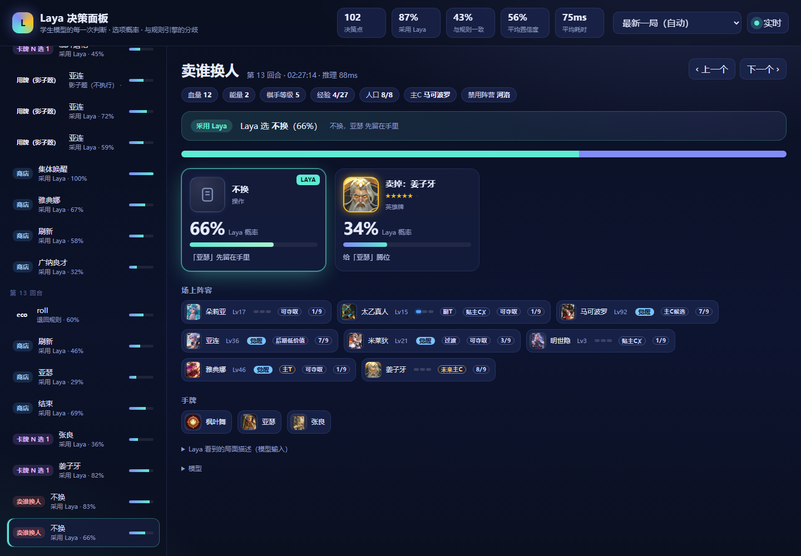
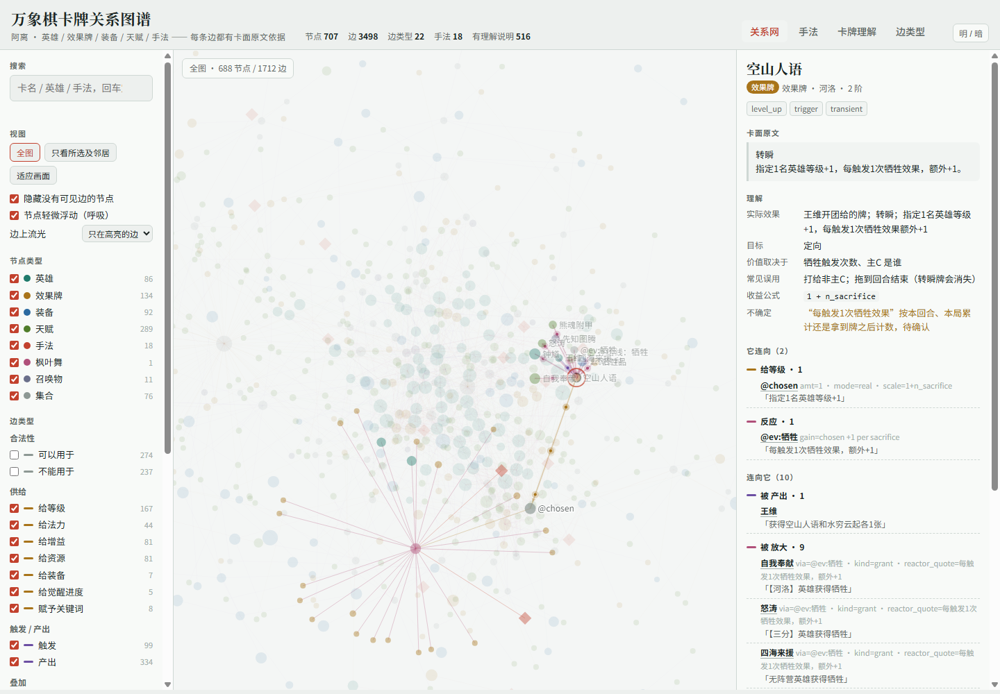
<sub>左：Laya 决策面板，实时显示每一次判断与选项概率　右：卡牌关系图谱，707 个节点、3,498 条有卡面依据的关系</sub>

</div>

> [!TIP]
> **完整研究报告**（单个网页文件，约 3.6 MB，含 30 余张图、50 余张表）：
> 👉 [点此下载 wanxiangqi-research.html](https://github.com/RudAns/MaaAssistantWZWXQ/releases/download/models-2026-10-26/wanxiangqi-research.html)，下载后**双击用浏览器打开**即可阅读。
> GitHub 不能直接预览网页文件，所以需要先下载；仓库里的 `docs/index.html` 是同一份文件。

## 目录

- [为什么做这件事](#为什么做这件事)
- [主要结果一览](#主要结果一览)
- [系统结构](#系统结构)
- [训练的模型](#训练的模型)
- [感知：读懂截图](#感知读懂截图)
- [决策：微调 Laya](#决策微调-laya)
- [决策：CGNet 局面网络](#决策cgnet-局面网络)
- [卡牌关系图谱](#卡牌关系图谱)
- [关于评测的几点经验](#关于评测的几点经验)
- [目前的程度与开放问题](#目前的程度与开放问题)
- [快速开始](#快速开始)

---

## 为什么做这件事

以往让 AI 玩电子游戏，大多绕不开一个矛盾：**能把局面想清楚的模型都很慢**。
常见做法类似 **TAS（工具辅助竞速）**——暂停画面或逐帧推进，让模型长时间思考、录好后续操作，再恢复游戏执行。
这在单机游戏里可行，在多人实时对局里却行不通：服务器不会等人，商店、拍卖、天赋选择都有倒计时，对手也在同时操作。

大语言模型擅长读懂牌面效果、权衡"值不值"，但一次调用往往要数秒到数十秒，一个回合里几十个决策点等不起。
[**Laya**](https://huggingface.co/convaiinnovations/laya) 这类轻量决策模型改变了这一点：
我们用大模型对决策题给出的判断来微调 Laya 后，本地显卡上每道题约 **80 ms** 就能给出完整的选项概率；
感知侧的专用小模型每次推理在 **20 ms** 量级。"看到画面 → 理解局面 → 做出决定 → 点击拖拽"于是能在倒计时内连续完成。

万象棋还有一层难度：**没有接口，也没有可加速的模拟器**。所有状态只能从手机模拟器的截图里读出来，所有动作都要变成点击和拖拽。

| 难点 | 具体表现 |
|---|---|
| 感知 | 同一张卡不同等级立绘不同；数字徽章很小，常被特效、飞行动画、商店面板遮挡；界面有二十多种 |
| 决策 | 每局 15~20 回合，每回合十几到几十个决策点；牌效相互作用复杂，"值不值"高度依赖局面，难以写成规则 |
| 实时与执行 | 所有判断都要在倒计时内完成；拖拽可能失败或被游戏拒收，必须确认动作生效 |

---

## 主要结果一览

> [!NOTE]
> 真实排位连续 **1,100 余局**，段位从**白银**打到**至尊星耀 I**；有效对局 1,006 局平均名次 3.95、前三率 36.7%。

- **单位等级**三位数读对率 10.2% → **98.1%**；**格子占用**整帧全对 58.3% → **97.2%**
- **界面判断**在界面切换帧上 93.4%（OCR 判据）→ **98.0%**（界面分类模型）
- **OCR** 整帧 2,612 ms（框架内置）→ **91 ms**（TensorRT）；线上 1.7 万次卡名读数**没有一次**读出卡库外的字
- **Laya** 与大模型老师首选一致 **0.69~0.81**（三段近期测试集），规则引擎只有约 0.33；每题 p90 **88 ms**
- **CGNet** 经济题 top1 **0.79~0.88**；落后进度且升得起的 40 道线上题**全部**选择升级

---

## 系统结构

<p align="center">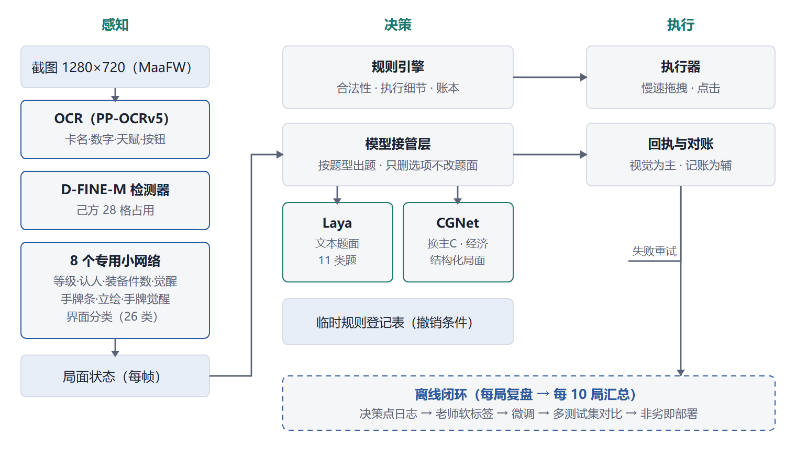</p>

**设计原则：智能优先。** 价值判断（值不值、选哪个、什么时候做）交给模型，规则只管四件事：合法性、感知、执行、执行模型已做出的决定。
模型判断错了，改的是题面、标注规范和训练数据，而不是在规则层打补丁；不得不加的临时规则都登记撤销条件，模型学会后关掉。

<details>
<summary><b>一帧要多久？（线上最近 11 局实测）</b></summary>

| 界面 | 帧数 | p50 | p90 |
|---|---:|---:|---:|
| 准备阶段 | 2,347 | 88&nbsp;ms | 130&nbsp;ms |
| 拍卖 | 2,498 | 48&nbsp;ms | 119&nbsp;ms |
| 战斗 | 1,531 | 62&nbsp;ms | 95&nbsp;ms |

以上是不执行动作的帧上，全部感知与决策的耗时。Laya 每题再加约 80 ms，CGNet 约 13 ms。
整条链路远短于游戏里商店、拍卖、天赋选择的倒计时，因此系统不需要暂停游戏。

</details>

---

## 训练的模型

共 12 个模型：10 个负责"看"，2 个负责"想"。

### 感知（看懂截图）

| 模型 | 任务 | 训练素材 | 关键结果 | p90 |
|---|---|---|---|---:|
| 🔤&nbsp;**OCR** | 读卡名、数字、天赋、按钮 | 测试集 1,241&nbsp;张 + 难例 212&nbsp;条 | 天赋认出 31%&nbsp;→&nbsp;**84%** | 91&nbsp;ms |
| 🎯&nbsp;**D-FINE-M** | 己方 28 格是否有单位 | 301&nbsp;张截图 | 整帧全对 58%&nbsp;→&nbsp;**97%** | 11.1&nbsp;ms |
| 🔢&nbsp;**等级识别** | 读单位等级 1~999 | 7,005&nbsp;个徽章 | 三位数 10%&nbsp;→&nbsp;**98%** | 3.9&nbsp;ms |
| ✨&nbsp;**觉醒进度** | 徽章外圈亮几段 | 3,069&nbsp;个徽章 | 精度 0.24&nbsp;→&nbsp;**1.00** | 0.5&nbsp;ms |
| 🧑&nbsp;**单位认人** | 场上单位是谁（84&nbsp;类） | 107,469&nbsp;张 | 覆盖率 91%&nbsp;→&nbsp;**99%** | 3.0&nbsp;ms |
| 🛡&nbsp;**装备件数** | 穿了几件装备 | 97,102&nbsp;张 | **100%**（旧规则 96%） | 12.5&nbsp;ms |
| 🃏&nbsp;**手牌条** | 手里几张牌、各在哪 | 13,656&nbsp;张 | 空位误判 94%&nbsp;→&nbsp;**0%** | 2.6&nbsp;ms |
| 🖼&nbsp;**手牌立绘** | 从立绘认卡（551&nbsp;类） | 35,330&nbsp;张 | 认对 53%&nbsp;→&nbsp;**98%** | 1.3&nbsp;ms |
| 🌟&nbsp;**手牌觉醒** | 手牌是否觉醒卡 | 3,886&nbsp;张 | 精度 0.24&nbsp;→&nbsp;**1.00** | 0.6&nbsp;ms |
| 🗂&nbsp;**界面分类** | 当前是哪种界面（26&nbsp;类） | 15,548&nbsp;张 | 切换帧 **98%**（OCR 93%） | 2.6&nbsp;ms |

<sub>p90 为单次推理耗时（RTX 3060 12G）：感知小模型走 CUDA，OCR 与 D-FINE 走 TensorRT；觉醒进度、手牌立绘、手牌觉醒为 CPU 一次 4 张的实测，GPU 上更快。</sub>

### 决策（做出判断）

| 模型 | 任务 | 训练素材 | 关键结果 | p90 |
|---|---|---|---|---:|
| 🧠&nbsp;**Laya（微调）** | 买牌、刷新、天赋、换人、拍卖等 11&nbsp;类题 | 约 3 万道带标注的题 | 与老师首选一致 **0.69**（规则约 0.33） | 88&nbsp;ms |
| 🕸&nbsp;**CGNet** | 换主C、经济节奏 | 19,455&nbsp;道带标注的题 | 经济题 0.76&nbsp;→&nbsp;**0.79** | 13.5&nbsp;ms |

<details>
<summary><b>模型参数量</b></summary>

| 模型 | 参数量 |
|---|---:|
| OCR | 官方权重 |
| D-FINE-M | 1,920&nbsp;万 |
| 等级识别 | 17&nbsp;万 |
| 觉醒进度 | 16&nbsp;万 |
| 单位认人 | 86&nbsp;万 |
| 装备件数 | 16&nbsp;万 |
| 手牌条 | 36&nbsp;万 |
| 手牌立绘 | 49&nbsp;万 |
| 手牌觉醒 | 7&nbsp;万 |
| 界面分类 | 107&nbsp;万 |
| Laya | 5,489&nbsp;万（可训练） |
| CGNet | 57&nbsp;万 |


</details>

---

## 感知：读懂截图

### OCR：宁缺勿错

OCR 读不出时，决策可以退回、重读或点开卡牌看详情；可一旦**读成另一张真实存在的卡**，下游就会做出合法但错误的决策——买错牌、用错牌。
所以方案的偏好是**宁缺勿错**：

- **找字轻量版 + 认字服务器版**：服务器版找字在窄区域里会把图标和描述行框进来，天赋认对率反而跌到 66%；
- **闭集解码**：认字结果只在卡库 925 个卡名里解码，手牌难例读错从 12 次降到 **1** 次；
- **切图区域修正**：天赋卡名直接认出率 31% → 84%，没有动模型；
- **TensorRT FP16**：整帧识别 377 ms → **91 ms**，逐帧结果与 CPU 一致。

| 线上卡名读数（最近 11 局） | 读数次数 | 命中卡库 | 卡库外 |
|---|---:|---:|---:|
| 商店卡名 | 3,969 | 98.9% | 0 |
| 手牌卡名 | 13,534 | 98.9% | 0 |
| N 选 1 卡名 | 245 | 100% | 0 |

### 视觉：固定区域裁图 + 专用小网络

游戏 UI 贴图（数字徽章、角标、觉醒雕像、按钮）位置固定、样式不随皮肤变化，十几万参数的网络就能学会；
像素阈值会被偏色立绘骗到，OCR 在小字号数字上又最弱。因此除检测器用预训练权重微调外，其余小模型都**从头训练**。

**标签从哪来？** 不靠人工逐张画框，而是让多路证据互相印证：

1. 旧方法的读数作初稿；
2. 游戏不变量：人口对账、等级单调不减、觉醒段按固定顺序点亮；
3. 更好视角下的读数迁移：点开详情读到的名字、不叠放时读到的卡名，迁移到同一对象在差视角下的样本；
4. 账本一致：已执行的动作与读数一致才当强标签。

训练集只保留多路证据一致的样本；测试集逐张复核，按对局切分，与它替换的旧方法在同一批帧上比：

| 模型 | 主指标 | 旧方法 | 模型 |
|---|---|---:|---:|
| D-FINE-M | 整帧 28 格全对 | 58.3% | **97.2%** |
| 等级 | 1~99 读对 | 24.7% | **100%** |
| 装备件数 | 复核集准确 | 96.4% | **100%** |
| 手牌条 | 已知空位误报 | 94.3% | **0%** |
| 手牌觉醒 | 测试精度 | 0.24 | **1.00** |
| 界面分类 | 切换帧准确 | 93.4% | **98.0%** |

<table>
<tr>
<td width="33%">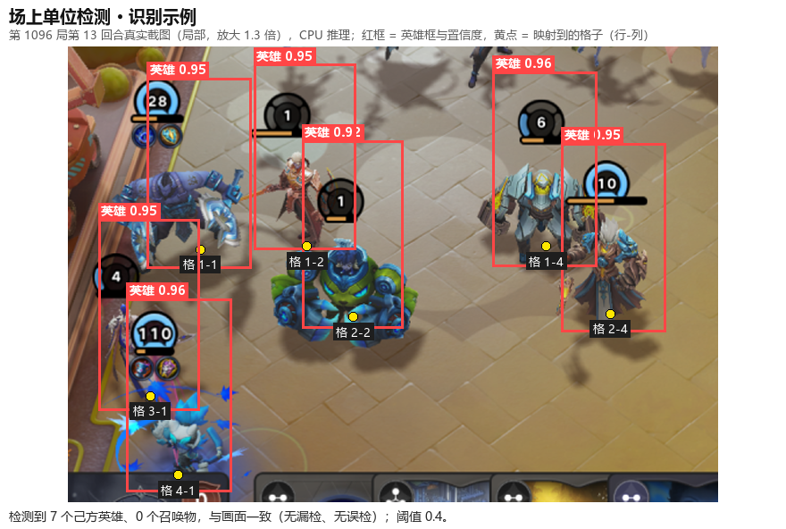<br><sub><b>场上单位检测</b>：7 个英雄全部检出并映射到格子</sub></td>
<td width="33%">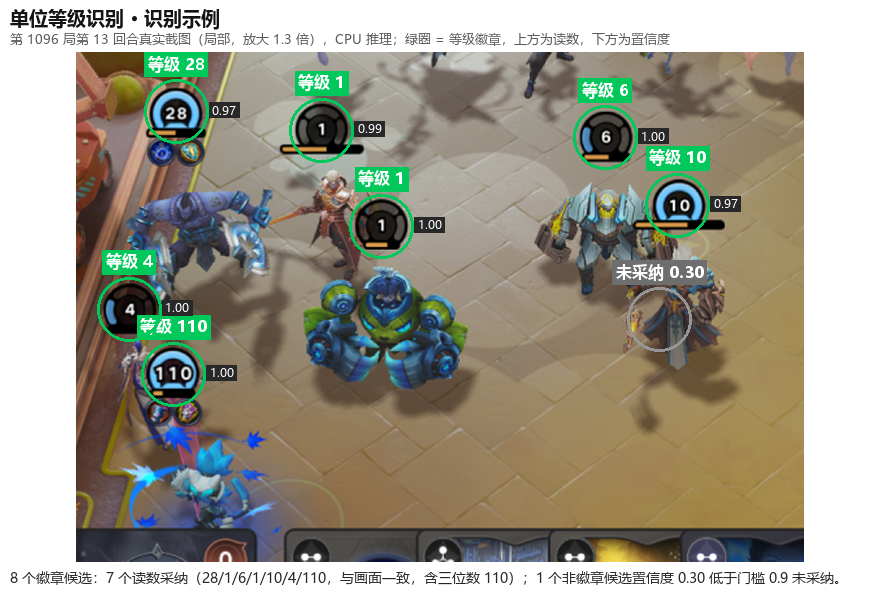<br><sub><b>等级识别</b>：含三位数 110 在内全部读对</sub></td>
<td width="33%">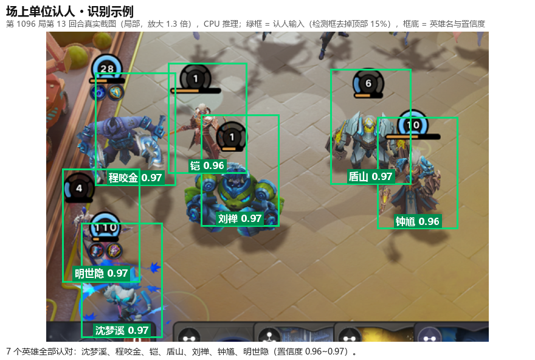<br><sub><b>单位认人</b>：7 个英雄全部认对，置信度 0.96~0.97</sub></td>
</tr>
<tr>
<td>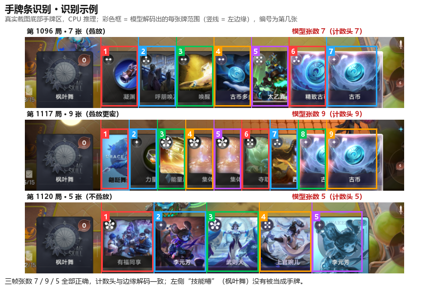<br><sub><b>手牌条</b>：叠放的 7 张、9 张牌张数全对</sub></td>
<td>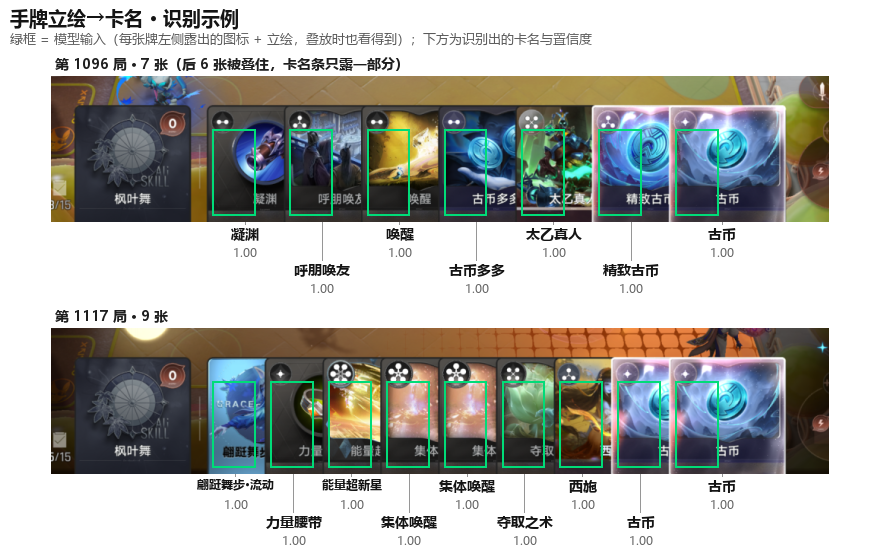<br><sub><b>手牌立绘 → 卡名</b>：卡名被遮住时仍全部认对</sub></td>
<td>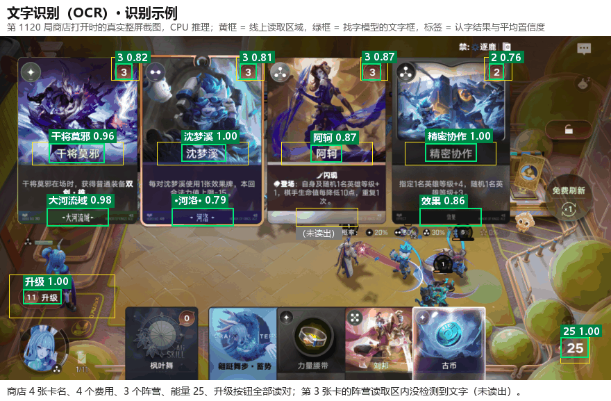<br><sub><b>OCR</b>：商店卡名、费用、阵营、能量</sub></td>
</tr>
</table>

<details>
<summary><b>训练样本长什么样</b></summary>

<table>
<tr>
<td width="50%">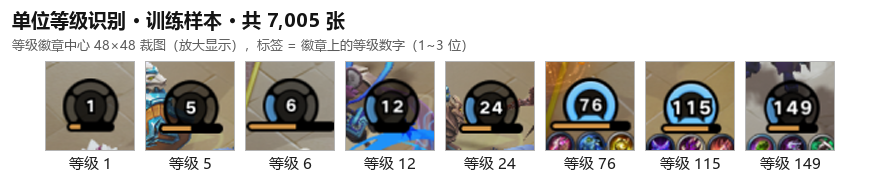<br><sub>等级识别训练样本（7,005 个）</sub></td>
<td width="50%">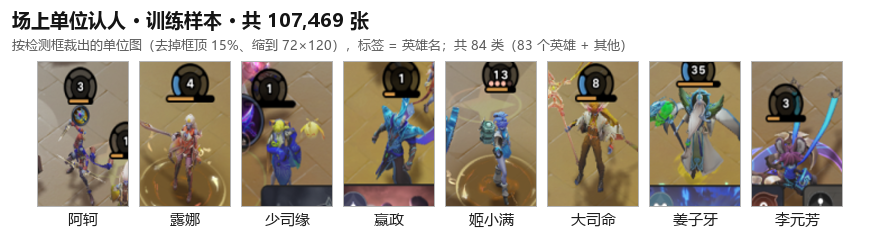<br><sub>单位认人训练样本（107,469 张，84 类）</sub></td>
</tr>
<tr>
<td>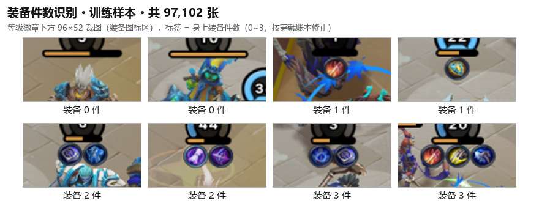<br><sub>装备件数训练样本（97,102 张）</sub></td>
<td>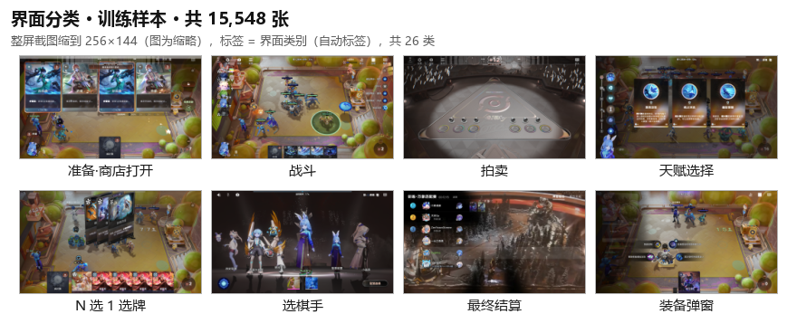<br><sub>界面分类训练样本（15,548 张，26 类）</sub></td>
</tr>
</table>

</details>

<details>
<summary><b>线上表现（最近 11 局）</b></summary>

| 指标 | 结果 |
|---|---:|
| 界面分类与 OCR 判断一致 | 97.4%（8,533 帧） |
| OCR 认不出的帧，由界面模型接管 | 每局约 73 次 |
| 检测器数出的人数 = 人口读数 | 94.7% |
| 认人 / 等级 / 觉醒进度有读数 | 98.2% / 99.4% / 99.5% |
| 回合号、能量、禁用阵营读数有效 | 100% |

</details>

---

## 决策：微调 Laya

[Laya](https://huggingface.co/convaiinnovations/laya) 是一个开源的轻量决策模型：读入一段"题目 + 选项"的文本，直接输出每个选项的概率，速度快、概率经过校准。
我们在它的基础上用万象棋的决策题做微调。

万象棋一回合里要做十几类决策：买哪张、刷不刷新、升不升级、天赋三选一、手里的牌用不用、人口满了卖谁、拍卖争哪件……
手写规则能保证动作合法，却很难做好价值判断——早期测试集上规则引擎与老师最佳选项只有约**三分之一**一致。
分工是：**大模型负责准确，Laya 负责速度**。

<p align="center">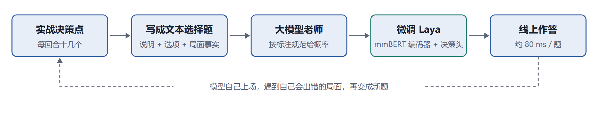</p>

**题从哪来？** 全部来自实战。线上每个决策点都写成题、记入日志；复盘时去掉模型的答案，就成了标注素材。
这是一个 DAgger 式的循环——模型自己上场，才会遇到它自己会出错的局面。离线出题与线上出题共用同一套代码，训练和部署看到的文本逐字一致。

| 题型 | 题数 | 占比 |
|---|---:|---:|
| 商店行动（买、刷新、升级、停手） | 41,612 | 44.1% |
| 用牌 | 12,710 | 13.5% |
| 换人 | 9,743 | 10.3% |
| 免费选牌 | 6,120 | 6.5% |
| 卖手牌 | 6,070 | 6.4% |
| 天赋 | 5,172 | 5.5% |
| 主C | 4,097 | 4.3% |
| 拍卖 | 3,931 | 4.2% |

<sub>题库共 73,512 道，其中约 3 万道带大模型老师的软标签用于训练。</sub>

**老师怎么标？** 大模型按一份持续更新的标注规范，给每个选项打一个概率分布；Laya 学的是这个分布，而不是胜负。

**怎么判断训练出的新版本更好？**

- 测试题按**整局**划出（同一局的相邻决策高度相关），分近期新题、固定留出、按错误类别抽的定向子集三类；
- 主指标 **tmass**：老师分布在模型所选选项上的概率质量——选了老师给 0.35 的次优项得 0.35 分而不是 0；
- 多个测试集配对比较，**只有明显更差才不换**。

| 测试集 | 题数 | 与老师首选一致 | tmass |
|---|---:|---:|---:|
| 近期段 1 | 459 | 0.691 | 0.541 |
| 近期段 2 | 580 | 0.726 | 0.562 |
| 近期段 3 | 373 | 0.807 | 0.608 |
| 固定留出集 | 287 | 0.641 | 0.437 |

<table>
<tr>
<td width="50%">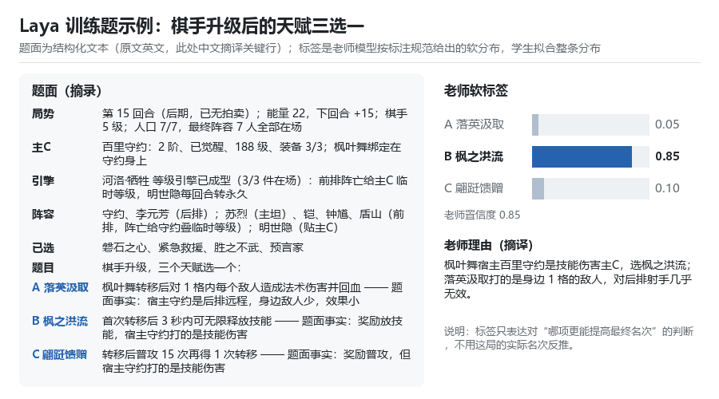<br><sub><b>训练题</b>：题面事实 + 大模型老师的软标签分布</sub></td>
<td width="50%">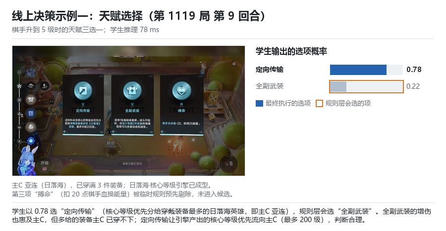<br><sub><b>线上天赋三选一</b>：以 0.78 选"定向传输"，让核心等级优先流向主C</sub></td>
</tr>
<tr>
<td>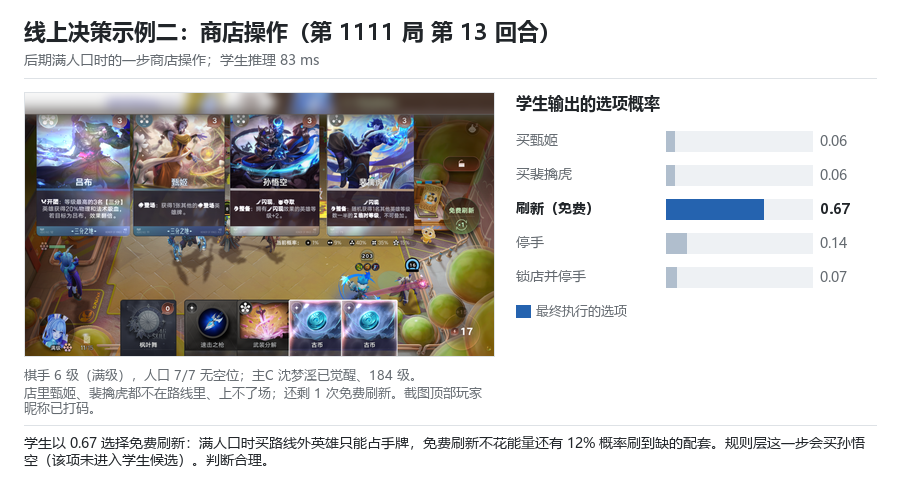<br><sub><b>线上商店</b>：满人口、店里两张都上不了场，选免费刷新</sub></td>
<td>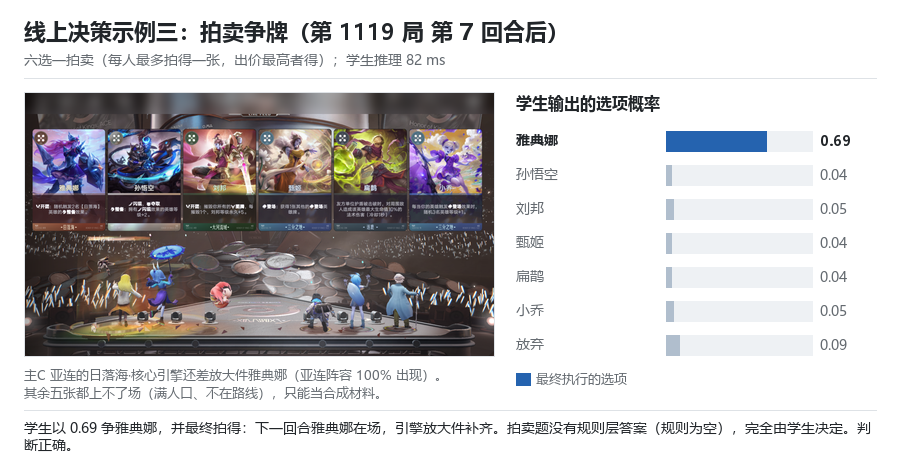<br><sub><b>线上拍卖</b>：争引擎缺的雅典娜，最终拍到</sub></td>
</tr>
</table>

<details>
<summary><b>Laya 线上表现（最近 11 局，1,518 道题）</b></summary>

| 题型 | 题数 | 平均置信度 | p90 延迟 |
|---|---:|---:|---:|
| 商店行动 | 838 | 0.557 | 86&nbsp;ms |
| 用牌 | 234 | 0.675 | 87&nbsp;ms |
| 换人 | 105 | 0.613 | 88&nbsp;ms |
| 卖手牌 | 83 | 0.650 | 78&nbsp;ms |
| 天赋 | 58 | 0.796 | 86&nbsp;ms |
| 拍卖 | 43 | 0.456 | 89&nbsp;ms |

95.8% 的题直接执行 Laya 的首选；首选当时不合法、改执行次选的只有 0.5%。

</details>

---

## 决策：CGNet 局面网络

换主C 要同时比较每个候选人与路线、装备、枫叶舞绑定、已得天赋之间的关系，这类**关系密集**的题交给结构化网络更合适：

- 一道题表示成**对象集合**（场上单位、手牌、商店牌、天赋、选项、路线缺件……），每个对象由卡牌图谱节点嵌入 + 卡面文本向量 + 数值特征组成；
- 对象两两之间有 **110 个关系通道**（图谱边类型、选项指向、阵容共现……），以**注意力偏置**的方式进入 Transformer——关系不改变对象内容，只改变谁更该关注谁；
- 输出是选项指针：在本题选项上做 softmax。

两类模型在同一批题上对比：CGNet 在换主C 题上比 Laya 高 **0.222**，在需要读多条汇总事实的商店题上低 0.072，因此两者分工。
CGNet 不输入血量与名次——血量是结果，不是局面结构。

| 训练素材 | 训练 | 测试 | 标签来源 |
|---|---:|---:|---|
| 换主C | 4,251 | 648 | 机制模拟为主 |
| 经济（升级 / 刷新 / 攒钱） | 6,344 | 502 | 大模型老师 |
| 换人（联合训练，线上不用） | 6,638 | 1,070 | 大模型老师 |

<table>
<tr>
<td width="50%">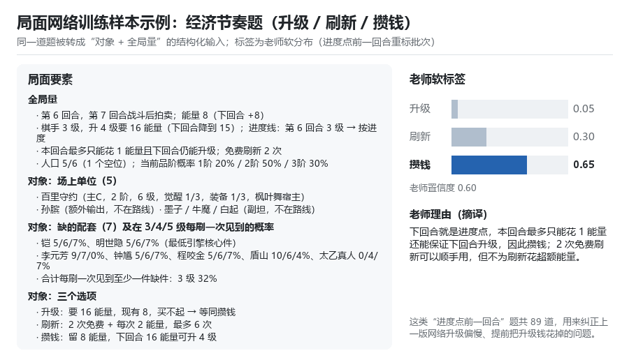<br><sub><b>经济题训练样本</b>：结构化局面 + 老师标签</sub></td>
<td width="50%">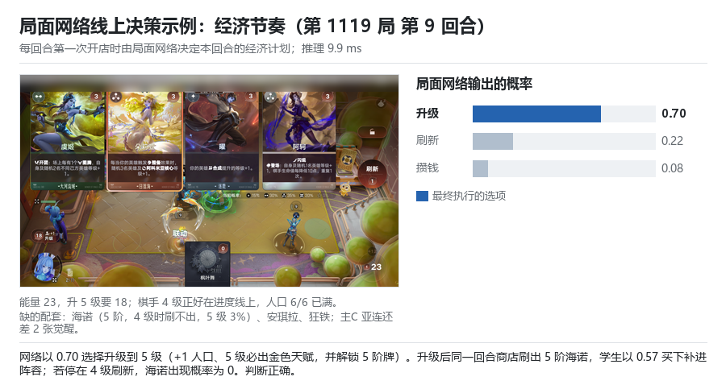<br><sub><b>线上经济决策</b>：以 0.70 选升级，升到 5 级同回合刷出 5 阶核心件</sub></td>
</tr>
</table>

<details>
<summary><b>CGNet 线上表现（最近 11 局，165 道经济题）</b></summary>

| 局面 | 题数 | 升级 | 刷新 | 攒钱 |
|---|---:|---:|---:|---:|
| 落后进度，升得起 | 40 | **40** | 0 | 0 |
| 落后进度，升不起 | 15 | 0 | 0 | **15** |
| 未落后，升得起 | 34 | 10 | 24 | 0 |
| 未落后，升不起 | 76 | 0 | 63 | 13 |

全部 165 道由 CGNet 作答，p50 11.4 ms、p90 13.5 ms。

</details>

---

## 卡牌关系图谱


官方卡库 925 张卡（英雄、效果、装备、天赋、棋手技能）整理成 **707 个节点、3,498 条边、22 种边类型、18 种手法**，
每条边都附卡面原文依据；516 张卡写了"理解"说明（实际效果、价值取决于什么、常见误用）。
它既是 CGNet 的输入底座，也是人读卡、查关系的工具：
[下载 card-graph.html](https://github.com/RudAns/MaaAssistantWZWXQ/releases/download/models-2026-10-26/card-graph.html) 后用浏览器打开，链接末尾加 `#卡名` 可以直达某张卡。

---

## 关于评测的几点经验

- **实战名次的噪声远大于直觉。** 一局名次的标准差约 1.7，二十来局均值的标准误仍有 0.35 左右，几十局以内的名次差距通常分不出两个模型版本。
  版本取舍以离线测试集为准，实战名次只看大样本的长期趋势。
- **赢局的共同点不一定是原因。** 失误检查条目数与名次正相关，只是因为打得越久的局记录的决策越多。
  比较两类局时，只用不随对局长度变化的指标，例如"主C 第几回合到位"：路线主C 第 4 回合前到场的局平均 3.39 名，晚到的局 4.29 名。
- **先看数据，再动模型。** 天赋识别率低，主因是切图区域偏了；人口读错，是商店面板遮住了数字。决策题判错时，先问"题面缺了什么信息"，再问"标签对不对"，最后才问"模型够不够大"。

---

## 目前的程度与开放问题

| 项目 | 现状 |
|---|---|
| 实战 | 1,100 余局；有效 1,006 局均名 3.95、前三率 36.7% |
| 段位 | 白银 → 至尊星耀 I |
| 棋手 | 只用了阿离 |
| 硬件 | RTX 3060 12G 实时运行；训练用一张 RTX 3090 |

还没回答的问题，**欢迎继续研究**：

- [ ] 换成其他棋手、冲击更高段位时，方法是否依然有效
- [ ] 把十个感知模型合并成更少的多头模型
- [ ] 减少决策标注对人工规范的依赖
- [ ] 把局面网络扩展到更多题型

---

## 快速开始

```bash
git clone https://github.com/RudAns/MaaAssistantWZWXQ.git
cd MaaAssistantWZWXQ
setup_env.bat          # 建 .venv、装依赖（也可按 docs/usage.md 手动安装）
```

1. 从 [Releases](https://github.com/RudAns/MaaAssistantWZWXQ/releases) 下载 `models-perception.zip`、`models-laya-R52.zip`、`models-cgnet.zip`，在仓库根目录解压；
2. 打开 MuMu 模拟器与游戏，停在大厅；
3. 按 [使用方法](docs/usage.md) 第 6 节启动。

> [!TIP]
> 先不加 `--execute` 跑一次"只看不点"的干跑模式，确认识别正常再真打。

> [!IMPORTANT]
> 训练数据（截图裁图、逐帧记录、老师标注，合计十几 GB）**因体积过大没有放进仓库**。

---

## 许可证

- 代码与模型：[PolyForm Noncommercial License 1.0.0](LICENSE)——允许学习、研究、个人使用与修改，**禁止商业用途**。
- 研究报告与文档：[CC BY-NC 4.0](https://creativecommons.org/licenses/by-nc/4.0/)。

> [!WARNING]
> 游戏用户协议禁止第三方自动化工具。本项目仅供学习研究，请使用小号，自行承担账号风险。
